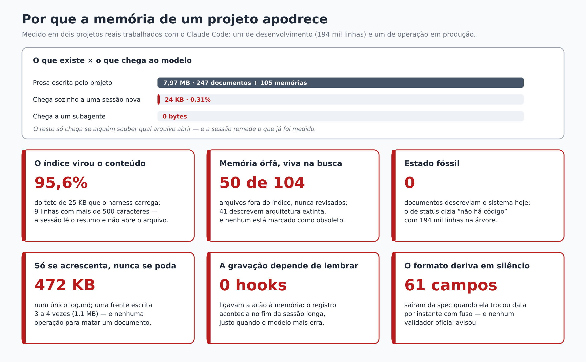
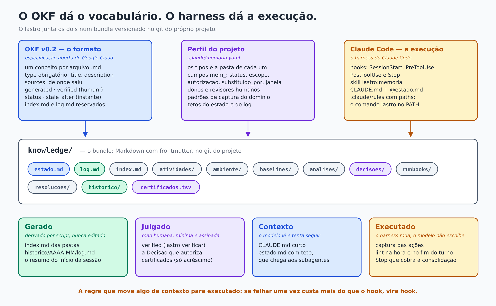
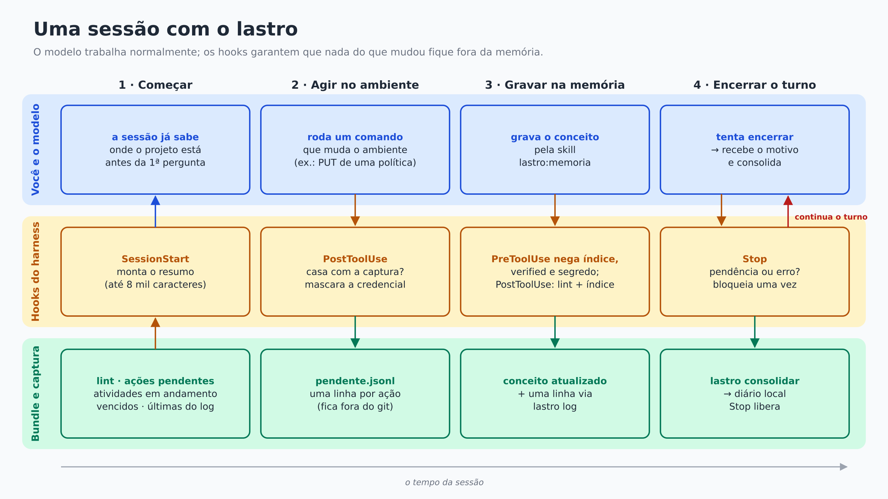
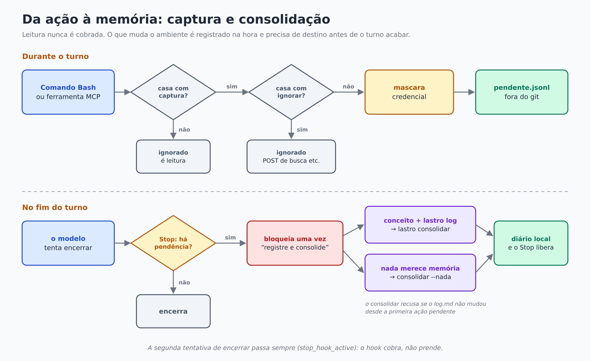
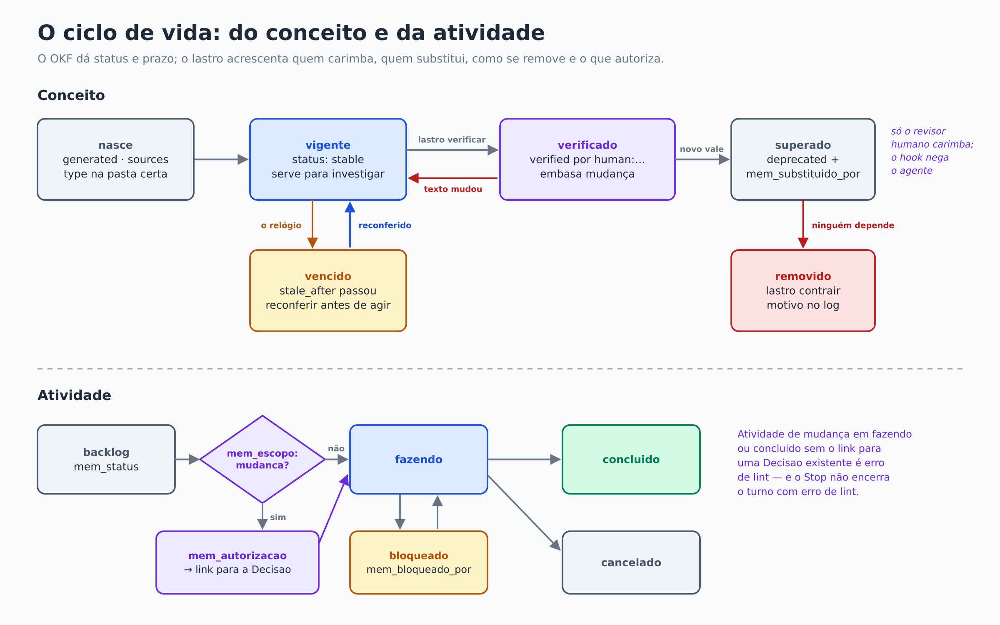

# Lastro

[](https://github.com/vpfeltrim/lastro/blob/main/plugins/lastro/.claude-plugin/plugin.json)
[](LICENSE)
[](https://code.claude.com/docs/en/plugins/overview)
[](https://github.com/GoogleCloudPlatform/open-knowledge-format)
[](https://www.python.org/)
[](plugins/lastro/tests/test_lastro.py)
[](#lastro)
[](https://github.com/vpfeltrim/lastro/commits/main)

**Memória de projeto para o Claude Code: um bundle [OKF](https://github.com/GoogleCloudPlatform/open-knowledge-format) que se mantém vivo sozinho.**

As ações, as análises, a configuração, as baselines e as decisões entram na memória **enquanto o
trabalho acontece**. Qualquer sessão nova já começa sabendo o que vale agora no projeto. A memória é
um conjunto de arquivos Markdown versionado no git do próprio projeto. O formato aberto é o Open
Knowledge Format (OKF v0.2), e o harness do Claude Code torna esse formato obrigatório em vez de
apenas recomendado.

> *Lastro*: o que sustenta um valor. Aqui, toda afirmação da memória diz de onde saiu, quem a
> confirmou e até quando vale.

---

## Por que existe

Uma sessão do Claude Code começa do zero. Ela sabe o que estiver no `CLAUDE.md`, no índice da auto
memory e no que ela mesma abrir. Num projeto curto, isso basta. Num projeto longo, a memória
apodrece, e o sintoma é sempre o mesmo: **sessões que se contradizem, remedem o que já foi medido e
não enxergam o projeto inteiro.**

O lastro nasceu da medição desse problema em dois projetos reais trabalhados com o Claude Code: um
de desenvolvimento de software, com cerca de 194 mil linhas, e um de operação de infraestrutura em
produção.



O que a medição mostrou:

- **Quase nada chega ao modelo.** O projeto de desenvolvimento tinha 7,97 MB de prosa (documentos e
  memórias). Uma sessão nova recebia sozinha 24 KB (0,31%), e um subagente, zero. O resto só chegava
  se alguém soubesse qual arquivo abrir.
- **O índice virou o conteúdo.** O `MEMORY.md` estava a 95,6% do teto de 25 KB que o harness
  carrega, com linhas de até 5.771 caracteres. A sessão lia o resumo e não abria o arquivo.
- **Memória órfã continuava viva na busca.** 50 dos 104 arquivos de memória estavam fora do índice.
  41 deles descreviam uma arquitetura que já não existia, e nenhum estava marcado como obsoleto.
- **Não havia estado.** Nenhum documento descrevia o sistema como ele era. O documento de status
  dizia "não há código escrito", com 194 mil linhas na árvore.
- **Só se acrescentava, nunca se podava.** O log chegou a 472 KB num único arquivo. Uma única frente
  de trabalho foi escrita de 3 a 4 formas diferentes (1,1 MB). Criar documento era um comando;
  remover não era operação nenhuma.
- **A gravação dependia de o modelo lembrar.** Ela acontecia no fim da sessão longa, justamente
  quando o modelo mais erra o formato.
- **O formato derivava em silêncio.** Quando a spec do OKF trocou data por instante com fuso, 61
  campos ficaram fora do padrão sem que nada avisasse. Não existe validador oficial.

O diagnóstico, em uma frase: **a memória era um registro cronológico só de acréscimo, sem estado
consolidado.** Guardava bem o que aconteceu e quase nada do que vale agora, que é justamente o que
uma sessão nova precisa.

## O que o lastro resolve

| problema medido | como o lastro trata |
|---|---|
| não há "o que vale agora" | `estado.md` com teto de tamanho, importado pelo `CLAUDE.md`, que também chega aos subagentes |
| a sessão não sabe o que existe | no início de cada sessão, um resumo gerado: atividades em andamento, ações pendentes, conceitos vencidos e as últimas linhas do log |
| o índice vira conteúdo e diverge | `index.md` de pasta **gerado** a partir das `description`; editá-lo à mão é negado |
| só se acrescenta | `lastro contrair` remove um conceito, mas só se ninguém depender dele, e registra o motivo; o log é rotacionado por mês |
| supersessão por aviso empilhado | `status: deprecated` + `mem_substituido_por` apontando para quem vale agora |
| nada diz se uma afirmação é confiável | `sources` obrigatório onde importa; `verified` só por revisor humano; `stale_after` com prazo |
| número que ninguém consegue reconferir | `lastro certificar` grava o valor junto com o comando que o produziu; o lint compara o documento com o certificado |
| a gravação depende de lembrar | um hook captura as ações que **mudam o ambiente**, e o turno não termina sem consolidá-las |
| o formato deriva | `lastro lint`, com controles negativos, roda na hora da escrita e no fim de cada turno |
| credencial vai parar no git | o lint e o hook recusam segredo no bundle; a captura mascara credenciais |

## Como funciona

### OKF + harness

O **OKF** (Open Knowledge Format, especificação aberta do Google Cloud) define o formato: uma pasta de
`.md` com frontmatter YAML. O único campo obrigatório é `type`, a identidade de um conceito é o
caminho do arquivo, e há campos para origem (`sources`), confiança (`generated`, `verified`) e ciclo
de vida (`status`, `stale_after`). O OKF não modela estado de trabalho, autorização, supersessão,
remoção nem dono, e não define processo nenhum. Como a spec obriga o consumidor a tolerar tipos e
campos desconhecidos, o lastro estende o formato sem sair dele, com campos de prefixo próprio
(`mem_`).

O **harness do Claude Code** separa duas naturezas de mecanismo:
- **contexto** (`CLAUDE.md`, rules, skills): o modelo lê e *tenta* seguir;
- **execução** (hooks): o harness roda, e o modelo não escolhe.

O lastro coloca no lado da execução tudo o que não pode falhar.



Tudo no lastro mora numa de quatro camadas:

| camada | o que é | exemplos |
|---|---|---|
| **Gerado** | derivado por script, nunca editado | `index.md` das pastas, histórico do log, resumo do início da sessão |
| **Julgado** | mão humana, mínima e assinada | `verified`, a `Decisao` que autoriza, certificados |
| **Contexto** | o modelo lê e tenta seguir | `CLAUDE.md` curto, `estado.md`, a skill, `.claude/rules/` |
| **Executado** | o harness roda | captura, lint na hora e no fim do turno, `Stop` que cobra a consolidação |

A regra para mover algo de *contexto* para *executado*: **se falhar uma vez custa mais do que o hook,
vira hook.**

### Uma sessão



1. **Começar.** O hook `SessionStart` entrega o resumo do bundle, e o `CLAUDE.md` importa o
   `estado.md`. A sessão sabe onde o projeto está antes da primeira pergunta.
2. **Agir.** Um comando que muda o ambiente é capturado pelo `PostToolUse` e gravado, com as
   credenciais mascaradas, num arquivo local fora do git.
3. **Gravar.** O modelo grava pela skill `lastro:memoria`. O `PreToolUse` nega editar índice
   gerado, escrever `verified` e gravar segredo. O `PostToolUse` confere o arquivo na hora e
   regenera os índices.
4. **Encerrar.** Se houver ação pendente ou erro de formato, o `Stop` impede o encerramento uma
   vez e diz o porquê. O modelo registra e consolida, e o turno termina.

### Captura e consolidação



Os padrões do perfil de cada projeto decidem o que é ação que muda o ambiente. Leitura nunca é
cobrada. Operações que usam POST mas apenas leem (uma busca, uma contagem) vão na lista `ignorar`.

No fim do turno, cada ação pendente precisa de um destino:
- **registrar:** o conceito afetado mais uma linha no log, e depois `lastro consolidar`. O comando
  recusa se o log não mudou desde a primeira ação pendente;
- **ou declarar que não merece memória:** `lastro consolidar --nada "<motivo>"`. O motivo fica no
  diário local.

A segunda tentativa de encerrar sempre passa (`stop_hook_active`): o hook cobra, mas não prende a
sessão.

### Ciclo de vida



- **O carimbo é humano.** Só quem está na lista de revisores do perfil aplica `verified`, com
  `lastro verificar`, no terminal. O hook nega o agente. Se o texto de um conceito verificado é
  reescrito, o carimbo pode cair.
- **O prazo vale.** Um `stale_after` vencido gera aviso: o conceito serve para investigar, mas
  precisa ser reconferido antes de embasar uma mudança.
- **Remover é uma operação.** `lastro contrair` mede quem aponta para o conceito e recusa enquanto
  alguém depender dele.
- **Autorização é um link.** Uma `Atividade` de escopo `mudanca` não chega a `fazendo` ou
  `concluido` sem `mem_autorizacao` apontando para uma `Decisao` existente.

### O bundle

```
knowledge/
├── index.md            # raiz, escrito à mão; só okf_version no frontmatter
├── estado.md           # onde o projeto está agora (com teto de tamanho)
├── log.md              # uma linha por fato, mais recente em cima, mês corrente
├── atividades/         # o trabalho e seu andamento
├── ambiente/           # peças do ambiente e configuração vigente
├── baselines/          # métricas de referência com janela de medição
├── analises/           # conclusões tiradas de dados
├── runbooks/           # como fazer, passo a passo
├── resolucoes/         # sintoma, causa, solução
├── decisoes/           # uma decisão por arquivo, com a data no nome
├── historico/          # logs de meses anteriores (gerado)
└── certificados.tsv    # valores certificados, só acréscimo (módulo opcional)
```

Fora do bundle, e fora do git: `.claude/memoria/pendente.jsonl` (ações capturadas) e
`.claude/memoria/diario/` (ações consolidadas). Dado bruto e credencial nunca entram no bundle; entra
a conclusão, com `sources` dizendo de onde saiu.

## Instalação

Requisitos: Claude Code (testado na 2.1.308), `python3` ≥ 3.9 com PyYAML, `git`.

```bash
git clone https://github.com/vpfeltrim/lastro.git ~/lastro
```

Em cada projeto que for usar o lastro:

```bash
claude plugin marketplace add ~/lastro --scope project
claude plugin install lastro@lastro --scope project
```

Com `--scope project`, a configuração fica em `.claude/settings.json` do projeto e vai junto no git.
Um marketplace adicionado de um diretório local carrega o plugin no lugar: um `git pull` em
`~/lastro` vale na próxima sessão de todos os projetos.

Para usar o comando `lastro` no terminal, fora do Claude Code (é lá que o revisor carimba):

```bash
ln -s ~/lastro/plugins/lastro/bin/lastro ~/.local/bin/lastro
```

Dentro do Claude Code, o plugin já coloca `lastro` no PATH.

## Adotar num projeto

Na raiz do projeto, rode `lastro init` (ou `/lastro:iniciar` no Claude Code). Ele cria, sem sobrescrever
nada:
- o perfil `.claude/memoria.yaml`;
- o bundle com as pastas dos tipos, o `index.md`, o `log.md` e o `estado.md`;
- uma regra em `.claude/rules/` que carrega só quando o bundle é tocado;
- o `CLAUDE.md`, se o projeto ainda não tiver um;
- as linhas do `.gitignore` para a captura.

Depois, ajuste o perfil:

```yaml
revisores: [human:maria]                 # quem pode carimbar verified
donos: [human:maria, process:memoria]    # quem responde por cada conceito

captura:
  bash:                                  # o que MUDA o ambiente neste domínio
    - '\bcurl\b.*(-X\s*|--request\s+)(PUT|POST|DELETE|PATCH)\b'
    - '\b(systemctl|service)\s+\S*\s*(restart|stop|start|reload)\b'
    - '\bkubectl\s+(apply|delete|patch|scale|rollout)\b'
  ignorar:                               # parece escrita, mas é leitura
    - '/_(search|count|msearch)\b'
  ferramentas:                           # ferramentas MCP que mudam o ambiente
    - 'mcp__.*__.*(create|update|delete)'

modulos: [certificados]                  # opcional
```

Se o projeto já tem `CLAUDE.md`, acrescente o import do estado (`@knowledge/estado.md`) e o contrato
de memória do [template](plugins/lastro/templates/CLAUDE.md). Mantenha o `CLAUDE.md` curto: inventário
de ambiente vai para `ambiente/`, não para ele.

`lastro lint` precisa terminar com `0 erro(s)`.

## Tipos e campos

Tipos do perfil padrão. Cada projeto pode mudar, mas tipo novo é decisão, não improviso.

| tipo | pasta | exige além da base | para quê |
|---|---|---|---|
| `Atividade` | `atividades/` | `mem_status`, `mem_escopo` | trabalho a fazer, fazendo ou feito |
| `Componente` | `ambiente/` | `sources`, `stale_after` | peça do ambiente e sua configuração |
| `Baseline` | `baselines/` | `sources`, `stale_after`, `mem_janela` | métrica de referência numa janela |
| `Analise` | `analises/` | `sources` | conclusão tirada de dados |
| `Runbook` | `runbooks/` | — | procedimento repetível |
| `Resolucao` | `resolucoes/` | — | sintoma, causa e solução |
| `Decisao` | `decisoes/` | data no nome do arquivo | o que foi decidido ou autorizado |
| `Estado` | `estado.md` | — | onde o projeto está agora |

Base de todo conceito: `type`, `title`, `description`, `dono`. Todo instante (`generated.at`,
`verified[].at`, `stale_after`, `mem_janela`) é ISO 8601 **com fuso**.

| campo do lastro | regra |
|---|---|
| `mem_status` | `backlog`, `fazendo`, `bloqueado`, `concluido` ou `cancelado` |
| `mem_escopo` | `leitura` ou `mudanca` (altera o ambiente) |
| `mem_autorizacao` | **link** para uma `Decisao`; obrigatório em mudança `fazendo` ou `concluido` |
| `mem_bloqueado_por` | link ou texto; obrigatório em `bloqueado` |
| `mem_substituido_por` | link para o conceito que vale agora; exige `status: deprecated` |
| `mem_janela` | `{de, ate}` da medição de uma baseline |
| `mem_certificados` | `[{chave, rotulo, valor}]`, conferidos contra `certificados.tsv` |

## Comandos

| comando | o que faz |
|---|---|
| `lastro perfil` | resume tipos, campos e regras do projeto |
| `lastro lint [--arquivo X] [--json]` | confere o bundle contra a spec e o perfil |
| `lastro indices` | regenera os `index.md` das pastas |
| `lastro log "<Rótulo>" "<fato>"` | uma linha no log, sob a data de hoje |
| `lastro log --rotacionar` | move os meses anteriores para `historico/AAAA-MM/` |
| `lastro briefing` | o resumo que a sessão recebe ao iniciar |
| `lastro pendentes` | ações capturadas e ainda não consolidadas |
| `lastro consolidar [--nada "<motivo>"]` | fecha as ações pendentes |
| `lastro contrair <arq> --motivo "..." [--executar]` | remove um conceito, se ninguém depender dele |
| `lastro certificar <chave> <rótulo> -- <comando>` | roda o comando e registra o valor |
| `lastro verificar <arq> --por human:<id>` | carimbo de revisão (só o revisor, no terminal) |
| `lastro init` | monta a estrutura num projeto |

## O que o lint confere

Erro faz o turno continuar. Aviso é para ler e julgar.

| código | regra |
|---|---|
| `E-FM`, `E-TYPE`, `E-PASTA`, `E-NOME` | frontmatter válido, tipo do perfil, na pasta dele, nome em kebab-case |
| `E-CAMPO`, `E-DONO`, `E-TAGS`, `E-SOURCES` | campos obrigatórios, dono da lista, formas da spec |
| `E-INSTANTE`, `E-ATOR`, `E-STATUS` | instante com fuso, ator no formato da spec, status do OKF |
| `E-VERIFIED` | carimbo só de revisor humano do perfil |
| `E-MEMSTATUS`, `E-ESCOPO`, `E-AUTORIZACAO` | estado da atividade e trava de autorização |
| `E-SUBST`, `E-JANELA`, `E-CERT` | supersessão, janela de baseline, certificado divergente |
| `E-LINK`, `E-INDEX`, `E-INDICE`, `E-RAIZ` | links, índices conformes à spec e atualizados |
| `E-LOG`, `E-ESTADO` | datas do log em ordem, teto do estado |
| `E-SEGREDO` | credencial no bundle |
| `A-STALE`, `A-SUBST`, `A-LOGLINHA` | prazo vencido, deprecated sem sucessor, linha de log longa |

A garantia vem do **estado, não da ferramenta**. Uma escrita feita por `sed` ou `cat >` escapa do
hook de edição, mas não escapa do lint no fim do turno.

## Testes

```bash
python3 -I -m unittest discover -s plugins/lastro/tests -v
```

São 46 controles negativos: cada regra do lint e cada hook têm um caso que **deve reprovar** e um que
deve passar. Um gate que não falha na entrada ruim não protege nada.

Os diagramas deste README são gerados por `python3 docs/diagramas/gerar.py` (precisa do
`rsvg-convert`).

## Limites

- **A captura enxerga só o que casa com os padrões do perfil.** Um wrapper de comando novo precisa
  entrar na lista.
- **Impedir o agente de rodar `lastro verificar` é melhor esforço**, como toda inspeção de comando
  Bash. O carimbo é evidente no git, não impossível de forjar.
- **Contradição entre dois textos em prosa não é detectada.** A literatura mostra que isso é instável
  até nos melhores modelos. A resposta do lastro é colocar o número que decide num certificado, onde
  duas afirmações se comparam por igualdade.
- **A spec do OKF ainda está na versão 0.2** e já mudou sem trocar de número. O lastro fixa o commit
  `ad30107` da `SPEC.md` como referência.

## De onde vêm as ideias

- **[Open Knowledge Format](https://github.com/GoogleCloudPlatform/open-knowledge-format)**: o formato do bundle.
- **[Documentação do Claude Code](https://code.claude.com/docs/en/hooks)**: hooks, memória, skills e plugins.
- **Revisão de crenças AGM** (Alchourrón, Gärdenfors e Makinson): bases de conhecimento apodrecem
  quando só a *expansão* existe. O `lastro contrair` é a operação de *contração*.
- **Monitor de referência** (Anderson, 1972): mediar todo caminho até o recurso. Aqui, conferindo o
  estado no fim do turno em vez de cada ferramenta.
- **Proof-carrying code** (Necula, 1997): o resultado viaja com o que permite conferi-lo sem refazer a
  computação. É a ideia dos certificados.
- **Living documentation**: o que é gerado tem entropia zero. Por isso os índices são gerados.

## Licença

[Apache-2.0](LICENSE).
